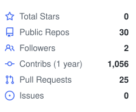
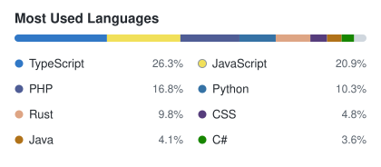

# สวัสดีครับ · Hi, I'm Salahuddin Benno

**ซอลาฮุดดีน เบนโน** · engineer building full-stack apps, AI agent workflows, and short hand-painted animations.

---

## สิ่งที่ผมทำ · What I work on

| ไทย | English |
| --- | --- |
| แอป full-stack (Next.js · Vercel · Neon) | Full-stack apps with Next.js, Vercel, and Neon |
| เวิร์กโฟลว์สำหรับ coding agents | Lean workflows for coding agents |
| แอนิเมชันลายพู่กัน + พากย์ไทย | Hand-painted cartoons with Thai narration |

---

## โปรเจกต์เด่น · Featured

### [FORGEX](https://github.com/Saladin2020/forgex)
Lean AI engineering workflow for coding agents — risk modes, contracts, codemaps, and review gates without heavy ceremony.

### [portfolio](https://github.com/Saladin2020/portfolio)
Personal portfolio site (TypeScript).

---

## สแต็กที่ชอบ · Stack

`TypeScript` · `Next.js` · `React` · `Node.js` · `Python` · `Neon / Postgres` · `Vercel` · `GitHub` · `p5.js`

---

## สถิติ · Stats

  <picture>
    <source media="(prefers-color-scheme: dark)" srcset="assets/github-stats-dark.svg" />
    
  </picture>
  <picture>
    <source media="(prefers-color-scheme: dark)" srcset="assets/top-langs-dark.svg" />
    
  </picture>

---

  <em>เปิดให้คุยเรื่องโปรเจกต์ งานวิศวกรรม และเครื่องมือ AI ได้เสมอครับ</em> 
  <em>Open to chats about engineering projects and AI tooling.</em>

