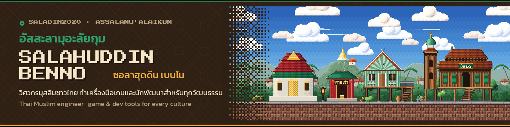
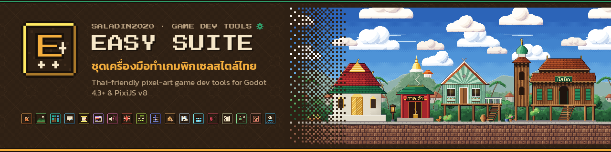
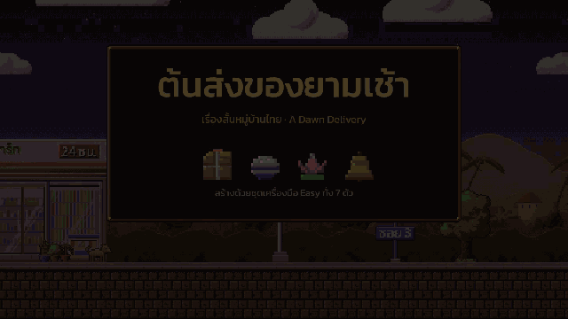
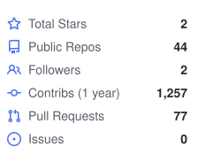
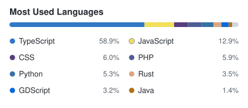

### อัสสะลามุอะลัยกุม 👋 / Assalamu'alaikum

ผม **ซอลาฮุดดีน เบนโน** (Salahuddin Benno) วิศวกรมุสลิมชาวไทย
ผมทำเครื่องมือทำเกมและเครื่องมือสำหรับนักพัฒนาที่ใช้ได้กับทุกวัฒนธรรม
งานหลักคือเว็บแอปแบบ full-stack, เวิร์กโฟลว์สำหรับ AI agent และ dev tools เล็ก ๆ ที่ทำงานเร็ว
เวลาว่างผมทำแอนิเมชันวาดมือ และเกม 2D อินดี้ด้วย Godot กับ Aseprite

I'm a Thai Muslim engineer. I build game and developer tools for every culture: full-stack web apps,
AI agent workflows and small, fast dev tools. On the side I make hand-painted animations and indie 2D
games with Godot and Aseprite, which is where **Easy Suite** came from.

ผมอยากให้เครื่องมือของผมเล่าเรื่องชุมชนที่วัด มัสยิด และศาลเจ้าอยู่บนถนนเดียวกันได้
ไม่ว่าจะเป็นพระบิณฑบาตยามเช้า ร้านโรตีหน้ามัสยิด หรือการเตรียมขนมตูปะช่วงวันรายอ

I want game makers to be able to tell stories where the wat, the masjid and the shrine share one street.

---

## 🏮 Easy Suite · ชุดเครื่องมือทำเกมพิกเซลสไตล์ไทย

  
  
  
  
  
  
  
  
  
  
  
  
  
  
  
  
  
  

Eighteen small, local-first tools for making cozy Thai pixel-art games: characters, dialogue portraits, side-view
scenes, top-down maps, dialogue, villager schedules, quests, Thai pixel fonts, UI, sound, particle effects, music,
cutscenes, items, turn-based battles and saves with Thai / English / Malay text, plus **Easy Kit**, which drives them
to build a whole playable game in one command, and **Easy Ship**, which packages it for the web, desktop and Android.
Each one has a CLI, a web editor and an MCP server, and exports to **Godot 4.3+** and **PixiJS v8**.
ทำตัวละคร ภาพหน้าตัวละคร ฉาก แผนที่ บทสนทนา ตารางชีวิตชาวบ้าน เควสต์ ฟอนต์พิกเซลไทย UI เสียง เอฟเฟกต์ เพลง คัตซีน ไอเทม
ระบบต่อสู้ และเซฟเกมได้ครบในชุดเดียว แล้วแพ็กเกมออกไปเล่นบนเว็บ คอมพิวเตอร์ และแอนดรอยด์
รองรับภาษาไทยเต็มรูปแบบ

**Multicultural village samples · หมู่บ้านพหุวัฒนธรรม:** the samples now include a southern Thai Muslim
community next to the temple, the market and the Chinese shrine. You get hijab, tudung, kopiah, songkok, baju
melayu, baju kurung and kain pelekat sprite parts, a wooden mosque and a kampung house, a Tadika, a roti
teashop and a halal stall. There's also a dialogue where neighbours greet each other with salam, a
Ramadan-to-Hari-Raya quest, rebana and rammana drums, and a green-and-gold Raya UI style.
ชุดตัวอย่างมีชุมชนมุสลิมภาคใต้ต่อจากวัด ตลาด และศาลเจ้าเดิม ทั้งเครื่องแต่งกาย มัสยิดไม้ บ้านกำปง ตาดีกา
ร้านโรตี บทสนทนาให้สลาม เควสต์รอมฎอนถึงวันรายอ เสียงรำมะนาและรือบานา

<table>
  <tr>
    <td align="center" valign="top" width="25%">
       
      <a href="https://github.com/Saladin2020/easysprite"><b>Easy Sprite</b></a> 
      ร้านแต่งตัวละครพิกเซล 
      Modular 48px pixel-art character sprites
    </td>
    <td align="center" valign="top" width="25%">
       
      <a href="https://github.com/Saladin2020/easyscene"><b>Easy Scene</b></a> 
      ฉากเกมด้านข้าง พารัลแลกซ์ 
      Side-view parallax scenes, autotiles & props
    </td>
    <td align="center" valign="top" width="25%">
       
      <a href="https://github.com/Saladin2020/easytilemap"><b>Easy Tilemap</b></a> 
      แผนที่มุมบน ออโต้ไทล์ หมู่บ้านไทย 
      Top-down 16px tile maps with autotiling
    </td>
    <td align="center" valign="top" width="25%">
       
      <a href="https://github.com/Saladin2020/easydialogue"><b>Easy Dialogue</b></a> 
      บทสนทนาเกม ภาษาไทยสระไม่ลอย 
      Branching dialogue, Thai-safe text & portraits
    </td>
  </tr>
  <tr>
    <td align="center" valign="top" width="25%">
       
      <a href="https://github.com/Saladin2020/easyquest"><b>Easy Quest</b></a> 
      ภารกิจเกม ต่อกับบทสนทนาได้ทันที 
      Text quests linked to Easy Dialogue
    </td>
    <td align="center" valign="top" width="25%">
       
      <a href="https://github.com/Saladin2020/easyui"><b>Easy UI</b></a> 
      ชุด UI พิกเซล ฟอนต์ไทย 
      Nine-slice pixel UI kit with Thai text
    </td>
    <td align="center" valign="top" width="25%">
       
      <a href="https://github.com/Saladin2020/easysfx"><b>Easy SFX</b></a> 
      เสียง 8-bit และเพลง chiptune 
      Deterministic 8-bit SFX & chiptune loops
    </td>
    <td align="center" valign="top" width="25%">
       
      <a href="https://github.com/Saladin2020/easyfx"><b>Easy FX</b></a> 
      พาร์ทิเคิลพิกเซลและเอฟเฟกต์ 
      Pixel particles and effects for 2D games
    </td>
  </tr>
  <tr>
    <td align="center" valign="top" width="25%">
       
      <a href="https://github.com/Saladin2020/easymusic"><b>Easy Music</b></a> 
      เพลงลูปไทย ระนาด ฆ้องวง ซอ 
      Seeded Thai loop music, seamless WAV/OGG
    </td>
    <td align="center" valign="top" width="25%">
       
      <a href="https://github.com/Saladin2020/easyanim"><b>Easy Anim</b></a> 
      คัตซีน กล้อง บทพูด เพลง 
      Cutscene timelines with Godot + Pixi runners
    </td>
    <td align="center" valign="top" width="25%">
       
      <a href="https://github.com/Saladin2020/easyitems"><b>Easy Items</b></a> 
      ไอเทม ร้านค้า กระเป๋า คราฟต์ 
      Items, shops, inventory, loot & crafting
    </td>
    <td align="center" valign="top" width="25%">
       
      <a href="https://github.com/Saladin2020/easysave"><b>Easy Save</b></a> 
      เซฟเกม แปลภาษา ไทย อังกฤษ มลายู 
      Save slots + Thai / English / Malay strings
    </td>
  </tr>
  <tr>
    <td align="center" valign="top" width="25%">
       
      <a href="https://github.com/Saladin2020/easyportrait"><b>Easy Portrait</b></a> 
      ภาพหน้าตัวละคร 9 อารมณ์ กะพริบตา 
      64px dialogue portraits: blink & talk
    </td>
    <td align="center" valign="top" width="25%">
       
      <a href="https://github.com/Saladin2020/easynpc"><b>Easy NPC</b></a> 
      ตารางชีวิตชาวบ้าน เดินจริงบนแผนที่ 
      NPC schedules, pathfinding, day / night
    </td>
    <td align="center" valign="top" width="25%">
       
      <a href="https://github.com/Saladin2020/easyfont"><b>Easy Font</b></a> 
      ฟอนต์พิกเซลไทย สระไม่ชน 
      Thai / Latin / Malay pixel fonts
    </td>
    <td align="center" valign="top" width="25%">
       
      <a href="https://github.com/Saladin2020/easybattle"><b>Easy Battle</b></a> 
      ต่อสู้ผลัดตา ปาร์ตี้ บอส สกิล 
      Turn-based party battles & bosses
    </td>
  </tr>
  <tr>
    <td colspan="2" align="center" valign="top">
       
      <a href="https://github.com/Saladin2020/easykit"><b>Easy Kit</b></a> · ทั้งเกมจากชุดเครื่องมือ Easy ในคำสั่งเดียว 
      One command → a playable Godot + Pixi game: characters, portraits, map, villagers, dialogue, quest, shop, battles, cutscene, music, FX, saves, th / en / ms
    </td>
    <td colspan="2" align="center" valign="top">
       
      <a href="https://github.com/Saladin2020/easyship"><b>Easy Ship</b></a> · ส่งเกมขึ้นเว็บ วินโดวส์ แอนดรอยด์ 
      Web / Windows / Linux / Android builds, itch.io-ready zips; dry run by default
    </td>
  </tr>
</table>

<b>Godot 4.3+ · PixiJS v8</b> · CLI · web editor · MCP server · MIT · local-first

<b>▶ A short story made only with Easy Suite (4× speed)</b> · เรื่องสั้น “ต้นส่งของยามเช้า”

 

---

## 🧰 More projects · โปรเจกต์อื่น ๆ

<table>
  <tr>
    <td width="50%" valign="top">
      <h3><a href="https://github.com/Saladin2020/Dice">🎲 Dice</a></h3>
      <b>Chunk once. Dedup everywhere. Restore bit-exact.</b> 
      Content-defined chunk store for large files and folder trees — FastCDC + BLAKE3 + zstd, with a native desktop UI and a cross-platform CLI.  
      
      
    </td>
    <td width="50%" valign="top">
      <h3><a href="https://github.com/Saladin2020/portfolio">🌐 portfolio</a> · <a href="https://portfolio-three-nu-t7xr2qj34b.vercel.app">live ↗</a></h3>
      <b>เว็บพอร์ตโฟลิโอภาษาไทย</b> 
      Personal portfolio — static Next.js site in Thai, prerendered and deployed on Vercel.  
      
      
    </td>
  </tr>
  <tr>
    <td width="50%" valign="top">
      <h3><a href="https://github.com/Saladin2020/forgex">⚒️ FORGEX</a></h3>
      <b>Engineer the plan. Execute with precision.</b> 
      Lean AI engineering workflow for coding agents — risk modes, task contracts, context packs and review gates, stdlib-only.  
      
      
    </td>
    <td width="50%" valign="top">
      <h3><a href="https://github.com/Saladin2020/onefile">📄 Onefile</a></h3>
      <b>A whole CMS in one <code>index.php</code>.</b> 
      Install, write, schedule, pin, RSS, revisions and TOTP 2FA — no frameworks, no <code>vendor/</code>, no build step.  
      
      
    </td>
  </tr>
</table>

---

## 🛠️ Stack · สแต็กที่ใช้

**Languages** &nbsp;

**Web & data** &nbsp;

**Games & art** &nbsp;

**Ship & create** &nbsp;

---

## 📊 Stats · สถิติ

  <picture>
    <source media="(prefers-color-scheme: dark)" srcset="assets/github-stats-dark.svg" />
    
  </picture>
  <picture>
    <source media="(prefers-color-scheme: dark)" srcset="assets/top-langs-dark.svg" />
    
  </picture>

Cards are generated daily from public data by <a href=".github/workflows/update-stats.yml">a GitHub Action</a>.

---

  <em>เปิดให้คุยเรื่องโปรเจกต์ งานวิศวกรรม เครื่องมือ AI และเกมอินดี้ได้เสมอครับ · ญะซากัลลอฮุค็อยร็อน</em> 
  Open to chats about engineering projects, developer tools, AI tooling and indie games. Thanks for stopping by!

