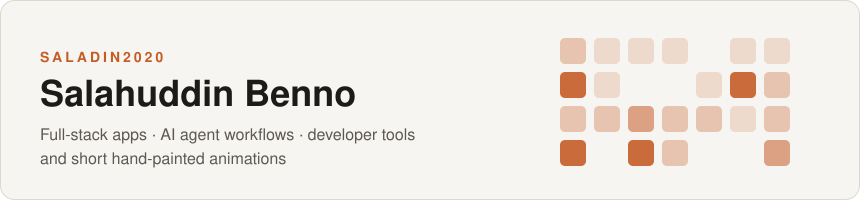

<picture>
  <source media="(prefers-color-scheme: dark)" srcset="assets/header-dark.svg" />
  
</picture>

### สวัสดีครับ 👋 ผม **ซอลาฮุดดีน เบนโน**

I build full-stack web apps, lean workflows for AI coding agents, small fast developer tools — and, on the side, hand-painted cartoons with Thai narration.

---

## 🧰 Featured projects · โปรเจกต์เด่น

<table>
  <tr>
    <td width="50%" valign="top">
      <h3><a href="https://github.com/Saladin2020/Dice">🎲 Dice</a></h3>
      <b>Chunk once. Dedup everywhere. Restore bit-exact.</b> 
      Content-defined chunk store for large files and folder trees — FastCDC + BLAKE3 + zstd, with a native desktop UI and a cross-platform CLI.  
      
      
    </td>
    <td width="50%" valign="top">
      <h3><a href="https://github.com/Saladin2020/easysprite">🏮 Easy Sprite</a></h3>
      <b>ร้านแต่งตัวละครพิกเซล</b> — compose modular 48px chibi sprites for a cozy Thai village game. Select · recolor · preview · export, with an MCP server.  
      
      
    </td>
  </tr>
  <tr>
    <td width="50%" valign="top">
      <h3><a href="https://github.com/Saladin2020/forgex">⚒️ FORGEX</a></h3>
      <b>Engineer the plan. Execute with precision.</b> 
      Lean AI engineering workflow for coding agents — risk modes, task contracts, context packs and review gates, stdlib-only.  
      
      
    </td>
    <td width="50%" valign="top">
      <h3><a href="https://github.com/Saladin2020/onefile">📄 Onefile</a></h3>
      <b>A whole CMS in one <code>index.php</code>.</b> 
      Install, write, schedule, pin, RSS, revisions and TOTP 2FA — no frameworks, no <code>vendor/</code>, no build step.  
      
      
    </td>
  </tr>
  <tr>
    <td colspan="2" valign="top">
      <h3><a href="https://github.com/Saladin2020/portfolio">🌐 portfolio</a> · <a href="https://portfolio-three-nu-t7xr2qj34b.vercel.app">live ↗</a></h3>
      Personal portfolio — static Next.js site in Thai, prerendered and deployed on Vercel.
      
      
    </td>
  </tr>
</table>

---

## 🛠️ Stack · สแต็กที่ใช้

**Languages** &nbsp;

**Web & data** &nbsp;

**Ship & create** &nbsp;

---

## 📊 Stats · สถิติ

  <picture>
    <source media="(prefers-color-scheme: dark)" srcset="assets/github-stats-dark.svg" />
    
  </picture>
  <picture>
    <source media="(prefers-color-scheme: dark)" srcset="assets/top-langs-dark.svg" />
    
  </picture>

Cards are generated daily from public data by <a href=".github/workflows/update-stats.yml">a GitHub Action</a>.

---

  <em>เปิดให้คุยเรื่องโปรเจกต์ งานวิศวกรรม และเครื่องมือ AI ได้เสมอครับ</em> 
  Open to chats about engineering projects, developer tools and AI tooling.

