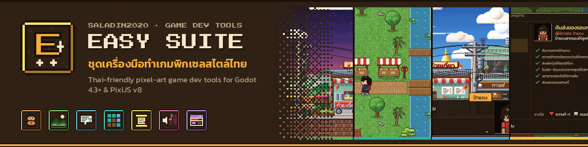
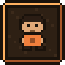
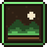
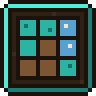
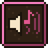
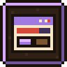
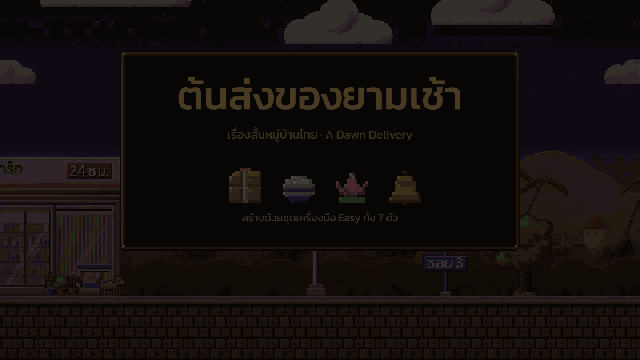

<picture>
  <source media="(prefers-color-scheme: dark)" srcset="assets/header-dark.svg" />
  
</picture>

### สวัสดีครับ 👋 ผม **ซอลาฮุดดีน เบนโน** · Salahuddin Benno

ผมทำเว็บแอปแบบ full-stack เวิร์กโฟลว์สำหรับ AI agent และเครื่องมือสำหรับนักพัฒนา
ส่วนเวลาว่างก็ทำแอนิเมชันวาดมือ และเกม 2D อินดี้ด้วย Godot กับ Aseprite

I build full-stack web apps, AI agent workflows and small, fast developer tools. On the side I make
hand-painted animations and indie 2D games with Godot and Aseprite, which is where **Easy Suite** came from.

---

## 🏮 Easy Suite · ชุดเครื่องมือทำเกมพิกเซลสไตล์ไทย

Seven small, local-first tools for making cozy Thai pixel-art games: characters, side-view scenes, top-down
maps, dialogue, quests, sound and UI. Each one has a CLI, a web editor and an MCP server, and exports to
**Godot 4.3+** and **PixiJS v8**. ทำตัวละคร ฉาก แผนที่ บทสนทนา เควสต์ เสียง และ UI ได้ครบในชุดเดียว
รองรับภาษาไทยเต็มรูปแบบ

<table>
  <tr>
    <td align="center" valign="top" width="25%">
       
      <a href="https://github.com/Saladin2020/easysprite"><b>Easy Sprite</b></a> 
      ร้านแต่งตัวละครพิกเซล 
      Modular 48px pixel-art character sprites
    </td>
    <td align="center" valign="top" width="25%">
       
      <a href="https://github.com/Saladin2020/easyscene"><b>Easy Scene</b></a> 
      ฉากเกมด้านข้าง พารัลแลกซ์ 
      Side-view parallax scenes, autotiles & props
    </td>
    <td align="center" valign="top" width="25%">
       
      <a href="https://github.com/Saladin2020/easydialogue"><b>Easy Dialogue</b></a> 
      บทสนทนาเกม ภาษาไทยสระไม่ลอย 
      Branching dialogue, Thai-safe text & portraits
    </td>
    <td align="center" valign="top" width="25%">
       
      <a href="https://github.com/Saladin2020/easytilemap"><b>Easy Tilemap</b></a> 
      แผนที่มุมบน ออโต้ไทล์ หมู่บ้านไทย 
      Top-down 16px tile maps with autotiling
    </td>
  </tr>
  <tr>
    <td align="center" valign="top" width="25%">
       
      <a href="https://github.com/Saladin2020/easyquest"><b>Easy Quest</b></a> 
      ภารกิจเกม ต่อกับบทสนทนาได้ทันที 
      Text quests linked to Easy Dialogue
    </td>
    <td align="center" valign="top" width="25%">
       
      <a href="https://github.com/Saladin2020/easysfx"><b>Easy SFX</b></a> 
      เสียง 8-bit และเพลง chiptune 
      Deterministic 8-bit SFX & chiptune loops
    </td>
    <td align="center" valign="top" width="25%">
       
      <a href="https://github.com/Saladin2020/easyui"><b>Easy UI</b></a> 
      ชุด UI พิกเซล ฟอนต์ไทย 
      Nine-slice pixel UI kit with Thai text
    </td>
    <td align="center" valign="middle" width="25%">
      <b>Godot 4.3+ · PixiJS v8</b> CLI · web editor · MCP server MIT · local-first
    </td>
  </tr>
</table>

<b>▶ A short story made only with Easy Suite (4× speed)</b> · เรื่องสั้น “ต้นส่งของยามเช้า”

 

---

## 🧰 More projects · โปรเจกต์อื่น ๆ

<table>
  <tr>
    <td width="50%" valign="top">
      <h3><a href="https://github.com/Saladin2020/Dice">🎲 Dice</a></h3>
      <b>Chunk once. Dedup everywhere. Restore bit-exact.</b> 
      Content-defined chunk store for large files and folder trees — FastCDC + BLAKE3 + zstd, with a native desktop UI and a cross-platform CLI.  
      
      
    </td>
    <td width="50%" valign="top">
      <h3><a href="https://github.com/Saladin2020/portfolio">🌐 portfolio</a> · <a href="https://portfolio-three-nu-t7xr2qj34b.vercel.app">live ↗</a></h3>
      <b>เว็บพอร์ตโฟลิโอภาษาไทย</b> 
      Personal portfolio — static Next.js site in Thai, prerendered and deployed on Vercel.  
      
      
    </td>
  </tr>
  <tr>
    <td width="50%" valign="top">
      <h3><a href="https://github.com/Saladin2020/forgex">⚒️ FORGEX</a></h3>
      <b>Engineer the plan. Execute with precision.</b> 
      Lean AI engineering workflow for coding agents — risk modes, task contracts, context packs and review gates, stdlib-only.  
      
      
    </td>
    <td width="50%" valign="top">
      <h3><a href="https://github.com/Saladin2020/onefile">📄 Onefile</a></h3>
      <b>A whole CMS in one <code>index.php</code>.</b> 
      Install, write, schedule, pin, RSS, revisions and TOTP 2FA — no frameworks, no <code>vendor/</code>, no build step.  
      
      
    </td>
  </tr>
</table>

---

## 🛠️ Stack · สแต็กที่ใช้

**Languages** &nbsp;

**Web & data** &nbsp;

**Games & art** &nbsp;

**Ship & create** &nbsp;

---

## 📊 Stats · สถิติ

  <picture>
    <source media="(prefers-color-scheme: dark)" srcset="assets/github-stats-dark.svg" />
    
  </picture>
  <picture>
    <source media="(prefers-color-scheme: dark)" srcset="assets/top-langs-dark.svg" />
    
  </picture>

Cards are generated daily from public data by <a href=".github/workflows/update-stats.yml">a GitHub Action</a>.

---

  <em>เปิดให้คุยเรื่องโปรเจกต์ งานวิศวกรรม เครื่องมือ AI และเกมอินดี้ได้เสมอครับ</em> 
  Open to chats about engineering projects, developer tools, AI tooling and indie games.

